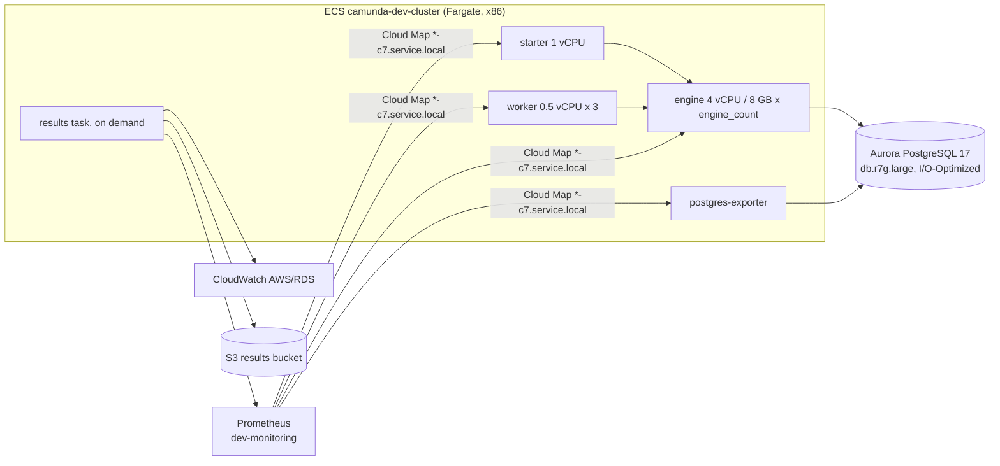

# C7 benchmark on AWS ECS (dev)

Runs the Camunda 7 benchmark next to the C8 ECS benchmark: same AWS account, VPC, ECS cluster and
Prometheus. Layout and Makefile conventions follow `aws/benchmark` and `aws/load_test`.
Apps, images, dashboard and report queries live in camunda/camunda [`load-tests/c7`](https://github.com/camunda/camunda/tree/main/load-tests/c7).

| Folder | Content | Lifetime |
|---|---|---|
| `c7_benchmark/` | Aurora PostgreSQL, engine, starter, workers, postgres-exporter, results task | Per run |
| `c7_results/` | S3 bucket `camunda-c7-benchmark-results-dev` | Long-lived |
| `../monitoring` | `c7` scrape job: discovers `*-c7.service.local` | Shared |

## What gets deployed



| Setting | Default | C8 ECS benchmark |
|---|---|---|
| Engine task | 4 vCPU / 8 GB, 1 task (`ENGINE_COUNT`) | 3 x 4 vCPU / 8 GB |
| Database | Aurora PostgreSQL 17.7, db.r7g.large, I/O-Optimized | Aurora db.t3.medium (secondary storage) |
| Load | 150 PI/s, `typical_payload.json`, 3 workers, capacity 60, 50 ms | 150 PI/s, same payload and worker settings |
| History | level `full`, no cleanup (growing state) | TTL P1D |

For an equal-compute comparison with C8, run `ENGINE_COUNT=3` and give the C8 benchmark the same Aurora class.

## Cost

| Item | Approx. |
|---|---|
| Aurora db.r7g.large I/O-Optimized | ~$0.39/h |
| Engine Fargate 4 vCPU / 8 GB | ~$0.20/h per task |
| Starter, 3 workers, exporter | ~$0.15/h |
| Total, 1 engine | ~$0.75/h, ~$6 per 8 h run |

Prices are eu-west-1 on-demand estimates. Destroy after each run.

## One-time setup

1. AWS access to the "Core Foundation Team - Playground" account (`030846071718`) as described in the
   [camunda-load-tests-ecs README](https://github.com/camunda/camunda-load-tests-ecs#aws-access):

   ```bash
   aws sso login --profile playground
   export AWS_PROFILE=playground AWS_REGION=eu-west-1
   ```

2. Images in `registry.camunda.cloud/team-zeebe` (the stable layer already holds pull credentials for it),
   built by the `c7-load-test-images.yml` workflow in camunda/camunda:

   ```bash
   # camunda/camunda: Actions > "Load test: C7 images" > Run workflow (tag 7.24.0-SNAPSHOT)
   ```

3. Results bucket:

   ```bash
   cd aws/c7_results
   terraform init -backend-config="key=dev/c7/results-bucket.tfstate"
   terraform apply -var environment=dev
   ```

4. Monitoring: the `c7` job in `aws/monitoring` must be deployed (`cd aws/monitoring/dev && make apply`).
   Without it the run works, but Prometheus has no C7 metrics and the results report is empty.

## Run

```bash
cd aws/c7_benchmark/dev
make plan                                   # check
make deploy                                 # ~10 min, mostly Aurora
make deploy STARTER_RATE=300                # change load in place
make results DURATION=1800                  # last 30 min -> s3://camunda-c7-benchmark-results-dev/c7/<run-id>/
make results START=2026-11-12T10:00:00Z END=2026-11-12T12:00:00Z RUN_ID=growing-2h
make destroy
```

Several benchmarks in parallel: `make deploy BENCHMARK_NUMBER=2` or `BENCHMARK_NAME=growing-1`.

From GitHub Actions: "Deploy/Destroy C7 Benchmark" (`c7-benchmark.yml`) with `action` = `deploy`,
`results` or `destroy`. It uses the same CI AWS credentials as the C8 benchmark workflow.

Dashboard: `./grafana.sh dev-c7-1` forwards the dev Prometheus through ECS Exec and opens Grafana with
the C7 Benchmark dashboard on http://localhost:3001.

## Results

Each `make results` writes one folder:

| File | Content |
|---|---|
| `metadata.json` | Run id, window, namespace, full configuration (images, rate, sizing, Aurora class) |
| `report.json`, `report.csv` | One row, produced by `loadtestctl report` (camunda/camunda) with [`report-queries-c7.yaml`](https://github.com/camunda/camunda/tree/main/load-tests/c7/results/report-queries-c7.yaml) |
| `timeseries.csv` | 1-minute series: started/completed PI/s, duration p50/p99, backlog, history rows, DB size, engine CPU |
| `cloudwatch.json` | Aurora CPU, DBLoad, commit throughput and latency, IOPS, connections (avg, max, points) |

The report uses the C8 key names where the meaning matches (`process_instances_per_second`,
`process_instance_execution_p50_ms` and `_p99_ms`, `response_latency_p50_ms` and `_p99_ms`), so C7 rows
can be appended to the C8 load-test spreadsheets and joined in analysis.

The same command works for every environment:

| Where | Command |
|---|---|
| Local | `make results DURATION=1800` in camunda/camunda `load-tests/c7` |
| GKE | `loadtestctl report c7-<name> --queries load-tests/c7/results/report-queries-c7.yaml ...` with a port-forwarded Prometheus |
| ECS | `make results` in `aws/c7_benchmark/dev` |

## Known gaps

- `wal_kib_per_process_instance` is empty on Aurora (no `pg_stat_wal`). Use `VolumeWriteIOPs` and
  `CommitThroughput` from `cloudwatch.json`.
- `container_cpu_usage_seconds_total` does not exist on Fargate; engine CPU comes from the JVM
  (`process_cpu_usage`).
- `files/postgres-queries.yaml` is a copy of `load-tests/c7/monitor/postgres/queries.yaml` in camunda/camunda.
  Update both together.
- The results bucket (`aws/c7_results`) is created once by hand; it is not part of the workflow.
